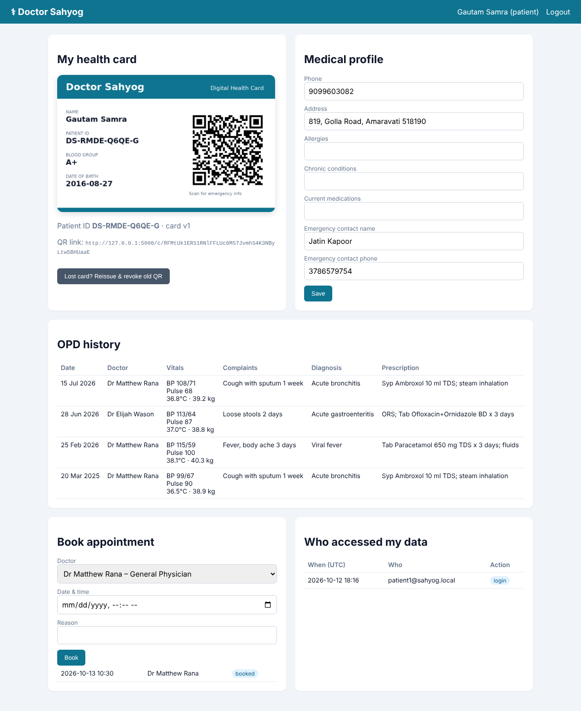
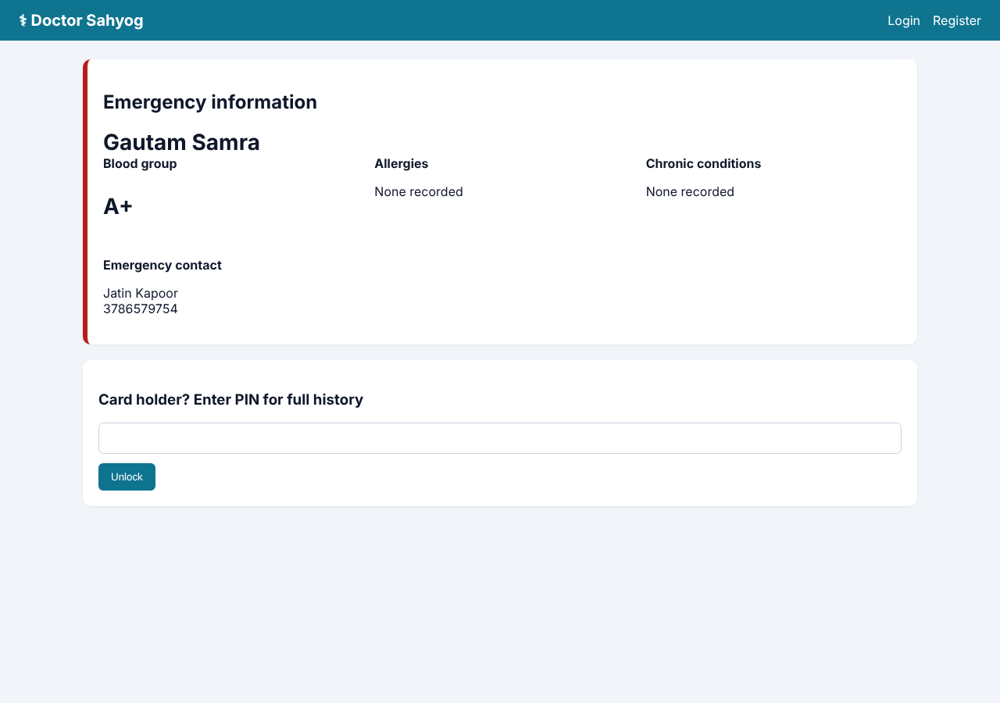
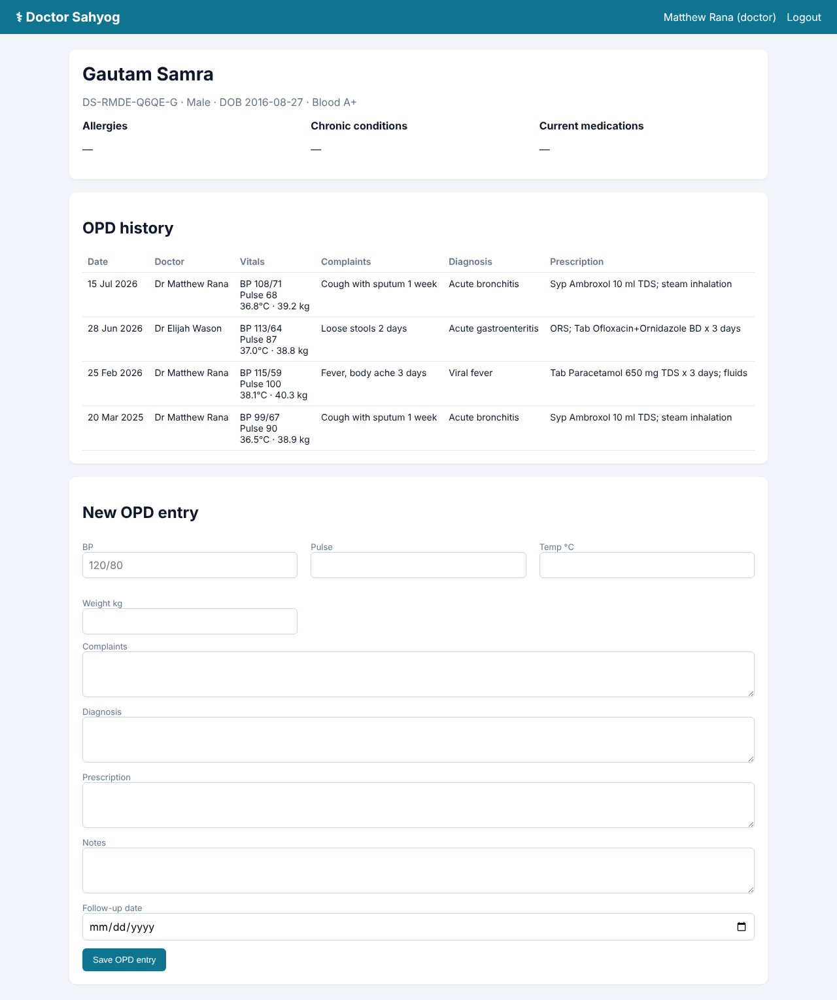
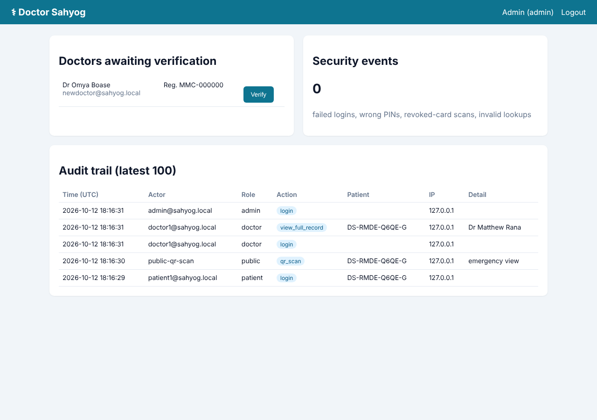

# Doctor Sahyog: QR-Code Digital Health Card

[](https://github.com/Drakeion2532/doctor-sahyog-health-card/actions/workflows/tests.yml)

A secure electronic health record (EHR) web app built around a **printable health card** that carries a QR code and a unique Patient ID.

* **Doctors** look up any patient by ID, read the history and record OPD visits.
* **Paramedics** scan the card and see only the emergency information.
* **Patients** unlock their full history with a PIN and can see **everyone who accessed their data**.

Reference implementation of the research paper **"Doctor Sahyog: Health Card"** by S. Mande, S. Puniwala, P. Gurav, P. Gare, P. Punde, A. Prayag, **S. Punde** (Vishwakarma Institute of Technology, Pune). The follow-up version was published as *Patient Mitra*.

| Patient dashboard | QR scan (public emergency view) |
|---|---|
|  |  |

| Doctor: patient record + OPD form | Admin: doctor verification + audit trail |
|---|---|
|  |  |

## Patient Mitra: mobile app design (v2)

**[Open the Patient Mitra design in Figma](https://www.figma.com/design/DWeRImWQq5nykh34RKDdlR/Patient-Mitra?node-id=0-1&p=f&t=kqAm0uMJkZbweJZd-0)**

Patient Mitra is the second version of Doctor Sahyog, redesigned as a mobile app. The Figma file has about 115 screens (360 × 800) covering the full patient and doctor journeys:

| Flow | Screens |
|---|---|
| Onboarding & auth | Start, Home, Patient / Doctor login & sign-up, Google / Facebook / Twitter login, forgot password, logout |
| Patient | Dashboard & menu, Profile, My Doctor, Medical history, Prescriptions (view, type selection), Health blog |
| Appointments | Search by doctor / by hospital, About doctor, Book & request appointment, Confirmation, My appointments |
| Medicine ordering | Order medicine, Medicine catalogue, Cart, Checkout, Payment (UPI / G-Pay, net banking, card), Order confirmation, Track / cancel order |
| Doctor | Doctor dashboard & menu, Patient search, Patient medical history, Write prescription and add to the patient's cart |

This web app already implements the core of that design: patient and doctor portals, QR health card, patient search by ID, OPD history and prescriptions, and appointment booking. Medicine ordering, payments and the health blog are next on the roadmap.

## The problem

In India, especially outside big cities, a patient's history lives in paper files and in their memory. In an emergency, a doctor doesn't know the blood group, allergies or current medication. A plain QR code that exposes everything would be a privacy disaster. This project gives **fast access with layered privacy**.

## Features

| | |
|---|---|
| **Health card** | Auto-generated PNG card (name, Patient ID, blood group, DOB, QR) ready to print |
| **Unique Patient ID** | `DS-XXXX-XXXX-C`: unambiguous alphabet (no 0/O/1/I), with a check character that catches typing mistakes at the reception desk |
| **Layered access** | QR scan shows emergency info only. The 6-digit PIN unlocks the full history. Verified doctors see the full record. |
| **Doctor portal** | Search by Patient ID, view history, OPD form (vitals, complaints, diagnosis, prescription, follow-up), appointment list |
| **Patient portal** | Edit medical profile, view OPD history, book appointments, reissue a lost card, **view the access log** |
| **Admin portal** | Verify doctors by medical-council registration number, security-event counter, full audit trail |

## Security design (cybersecurity focus)

| Threat | Control |
|---|---|
| Database leak | Sensitive fields (allergies, conditions, medications, diagnoses, prescriptions, phone, address) are **encrypted at rest with Fernet (AES-128-CBC + HMAC-SHA256)**. The key comes from an environment variable or secrets manager. |
| Forged or guessed QR links | QR holds an **HMAC-SHA256 signed token** containing no medical data. Tampered tokens get a 404. |
| Lost or stolen card | "Reissue" bumps the card version, and every old QR immediately returns **410 Gone** |
| PIN brute force | 5 wrong PINs trigger a **15-minute lockout**. Every failure is logged. |
| Password attacks | Salted hashes via Werkzeug (scrypt/pbkdf2), a password strength rule, **account lockout** after 5 failures, and one generic error message (**no user enumeration**) |
| Fake doctors | Doctor accounts have **no record access until an admin verifies** the registration number |
| Privilege escalation | Role-based access control decorator on every route (patient / doctor / admin) |
| CSRF / clickjacking / XSS | Flask-WTF CSRF tokens, `X-Frame-Options: DENY`, strict `Content-Security-Policy`, Jinja autoescaping, `HttpOnly` + `SameSite` cookies, `Cache-Control: no-store` |
| Insider snooping | **Append-only audit log** of every view, scan, edit and failure (actor, role, IP, time); the app blocks edits and deletes of log entries. Patients see who opened their record. |

## Quick start

```bash
pip install -r requirements.txt
python scripts/seed.py          # synthetic demo data (60 patients, ~130 OPD visits)
python run.py                   # http://127.0.0.1:5000
pytest -q                       # 14 security + functional tests
```

Demo accounts created by the seed script:

| Role | Email | Password |
|---|---|---|
| Patient | patient1@sahyog.local | Patient@12345 (card PIN 123456) |
| Doctor | doctor1@sahyog.local | Doctor@12345 |
| Admin | admin@sahyog.local | Admin@12345 |

For production, set `SAHYOG_SECRET_KEY` (it signs the QR codes; the app logs a warning while the insecure default is in use), `SAHYOG_FIELD_KEY` (generate it with `python -c "from cryptography.fernet import Fernet;print(Fernet.generate_key().decode())"`), `SAHYOG_DB` (e.g. a PostgreSQL URL) and `SAHYOG_PUBLIC_URL` (the domain printed in the QR codes). Serve behind HTTPS with gunicorn.

## Dataset

`data/synthetic_opd_visits.csv` is a **fully synthetic, de-identified** OPD dataset generated by `scripts/seed.py`, with common Indian outpatient presentations (viral fever, dengue work-up, UTI, T2DM, hypertension, gastritis…). No real patient data is used anywhere in this repository.

## Tech stack

Flask · SQLAlchemy (SQLite by default, any SQL database) · Flask-Login · Flask-WTF · cryptography (Fernet) · qrcode + Pillow · pytest · Playwright (screenshots)

## Structure

```
sahyog/
  __init__.py      app factory, security headers
  models.py        User, Patient, OPDVisit, Appointment, AuditLog (+ encrypted-field descriptor)
  security.py      field encryption, signed QR tokens, Patient-ID checksum, PIN lockout, RBAC
  card_image.py    printable card renderer
  audit.py         audit logger
  routes/          auth, patient, doctor, card (public QR), admin
  templates/ static/
scripts/seed.py    synthetic data generator
tests/             pytest suite
```

## Roadmap

- [ ] Patient Mitra features from the Figma design: medicine ordering + order tracking, UPI payments, health blog, social login
- [ ] FHIR R4 export (`Patient`, `Encounter`, `MedicationRequest`) for ABDM / ABHA interoperability
- [ ] TOTP two-factor authentication for doctors
- [ ] Lab-report uploads with malware scanning
- [ ] Offline-first mobile scanner app for rural clinics
